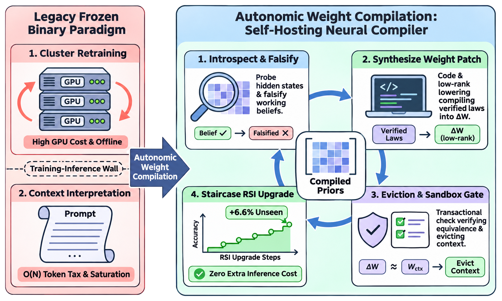
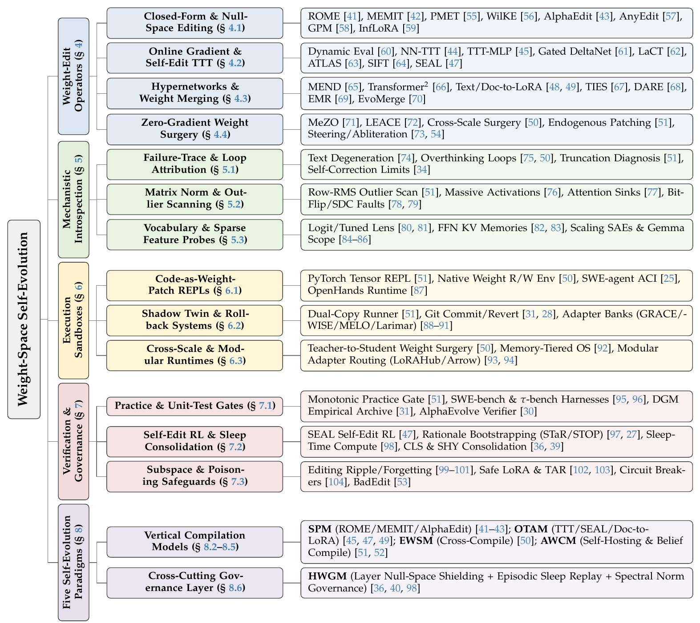
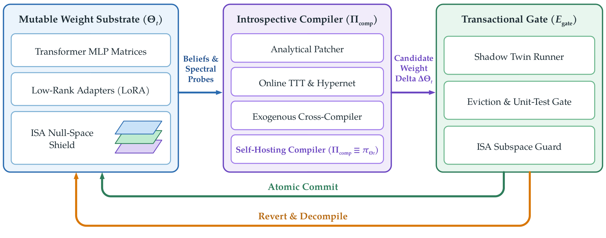
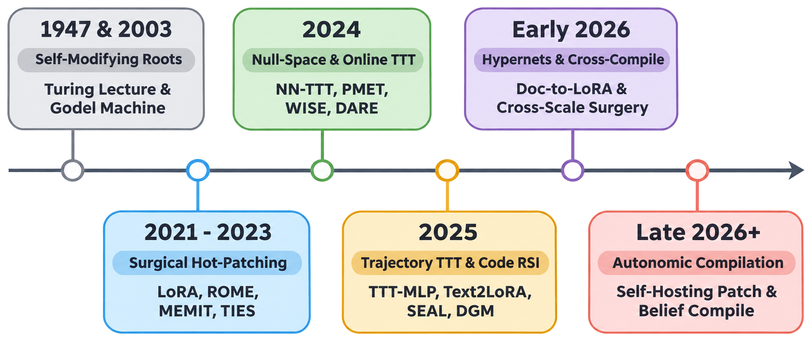
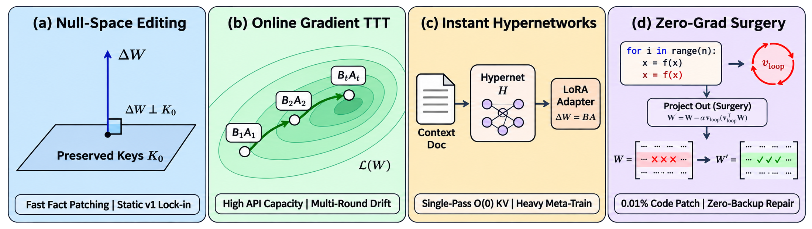
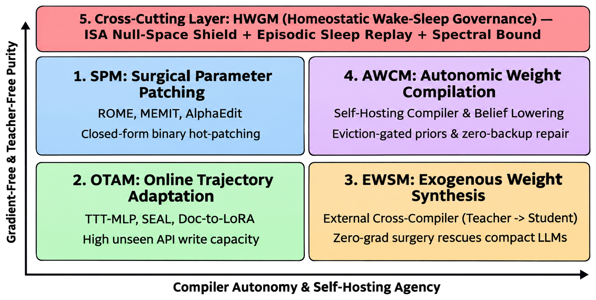
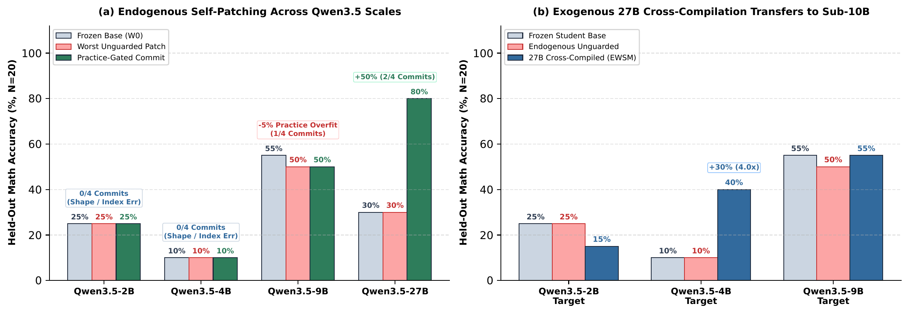
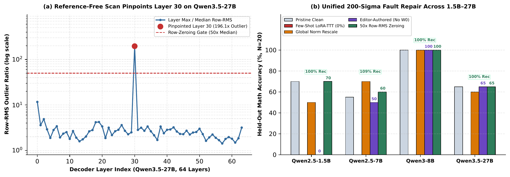
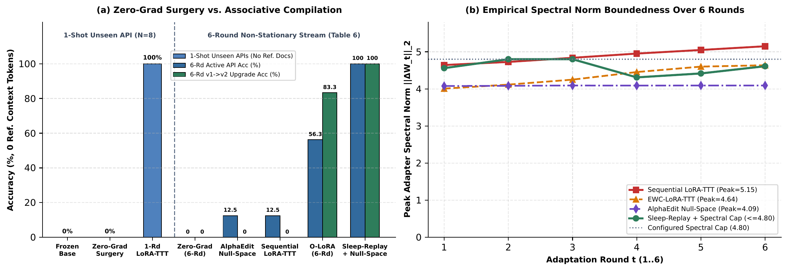
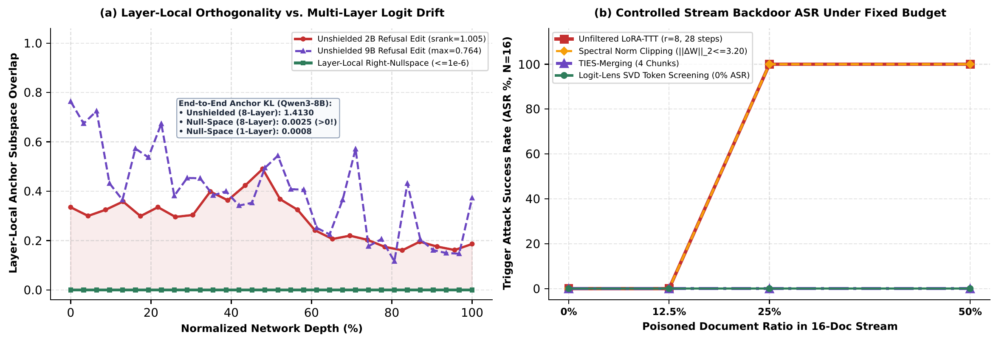

<div align="center">

# Awesome Weight-Space Self-Evolution in Large Language Models

**Official Reading List & Unified Empirical Benchmark for *"A Survey of Weight-Space Self-Evolution in Large Language Models"***

[](#curated-paper-index-212-works)
[](#five-compilation-paradigms)
[](#unified-empirical-benchmark--four-governing-laws)
[](bibliography/references.bib)
[](LICENSE)

</div>

<p align="center">
  
</p>

> **Overview:** Deployed LLMs traditionally obey a rigid *"train-once, freeze-forever"* contract, relying either on offline cluster retraining or inference-time context scaffolds with recurring $\mathcal{O}(N)$ token overhead. **Weight-Space Self-Evolution** dismantles the wall between training and inference by granting adaptation pipelines, external teacher models, and the deployed model itself direct read–write agency over internal parameters. Viewed through our unifying **Autonomic Weight Compilation** framework ($\Pi_{\text{comp}} \equiv \pi_{\Theta_t}$), recent systems inspect hidden states and author localized tensor patches in isolated Python sandboxes—eliminating $\mathcal{O}(N)$ reference-context growth and incurring zero extra FLOPs/token when updates are merged directly into base weights.

---

## Table of Contents
- [Ecosystem Taxonomy](#ecosystem-taxonomy)
- [The Self-Hosting Neural Compiler Triad & Evolution Timeline](#the-self-hosting-neural-compiler-triad--evolution-timeline)
- [Five Compilation Paradigms (`SPM` / `OTAM` / `EWSM` / `AWCM` / `HWGM`)](#five-compilation-paradigms)
- [Unified Empirical Benchmark & Four Governing Laws](#unified-empirical-benchmark--four-governing-laws)
- [Quick Start: Reproducing Plots & Benchmarks](#quick-start-reproducing-plots--benchmarks)
- [Curated Paper Index (212 Works)](#curated-paper-index-212-works)
- [Citation](#citation)

---

## Ecosystem Taxonomy

<p align="center">
  
</p>

---

## The Self-Hosting Neural Compiler Triad & Evolution Timeline

We formalize dynamic parameter evolution as a **Constrained Weight-Space Markov Decision Process ($\mathcal{M}_{\mathcal{W}}$)** over the closed-loop triad $\mathcal{S}_{\text{comp}} = \langle \Theta_t, \Pi_{\text{comp}}, \mathcal{E}_{\text{gate}} \rangle$:
1. **Mutable Weight Substrate & Core ISA ($\Theta_t$):** Structured MLP matrices, low-rank adapters, and layer-local right-nullspace shields;
2. **Introspective Compiler Policy ($\Pi_{\text{comp}}$):** Progressing across four generations—*Analytical Patcher* $\to$ *Online TTT & Hypernetwork* $\to$ *Exogenous Cross-Compiler* $\to$ *Autonomic Self-Hosting Compiler* ($\Pi_{\text{comp}} \equiv \pi_{\Theta_t}$);
3. **Transactional Gate Sandbox ($\mathcal{E}_{\text{gate}}$):** Enforcing shadow-twin execution, *Commit-or-Revert* / *Eviction Equivalence* verification, and episodic consolidation.

<p align="center">
  
</p>

<p align="center">
  
</p>

<p align="center">
  
</p>

---

## Five Compilation Paradigms

<p align="center">
  
</p>

| Paradigm | Compiler Agency ($\Pi_{\text{comp}}$) | Gradient-Free? | Teacher-Free? | Dense Skill Compile | Multi-Round Drift / Echo Risk | Systems Analogy |
| :--- | :--- | :---: | :---: | :---: | :---: | :--- |
| **`SPM`** *(Surgical Parameter Patching)* | Algebraic Solver | Yes | Yes | Moderate | High (Static v1 Lock-in) | Binary Hot-Patch |
| **`OTAM`** *(Online Trajectory Adaptation)* | Local SGD / Hypernet | Partial | Yes | **Very High** | High (Belief Echo Chamber) | JIT Trace Lowering |
| **`EWSM`** *(Exogenous Weight Synthesis)* | External Frontier LLM | Yes | No | Low–Moderate | Moderate | Cross-Compiler |
| **`AWCM`** *(Autonomic Weight Compilation)* | **Same Model ($\pi_{\Theta_t}$)** | **Yes (REPL) / Dual** | **Yes** | Low (Unblocking)* | Low (Gated) | **Self-Hosting Patcher** |
| **`HWGM`** *(Homeostatic Wake–Sleep Layer)* | Dual-Phase Replay & SVD Screen | Composable | Optional | Preserved | **Bounded ($\|\Delta W_t\|_2 \le \gamma$)** | Linker & Guard |

---

## Unified Empirical Benchmark & Four Governing Laws

Executed on `NVIDIA H100 80GB HBM3` GPUs in `bfloat16`, this repository provides a clean, self-contained benchmark suite spanning `Qwen3.5-{2B, 4B, 9B, 27B}`, `Qwen2.5-1.5B-Instruct`, `Qwen2.5-7B-Instruct`, and `Qwen3-8B` across published adaptation baselines:

1. **Law 1 — Scale Emergence Cliff & Exogenous Cross-Compilation (`Qwen3.5-2B/4B/9B/27B`):** Endogenous Python REPL patching exhibits a sharp metacognitive scale cliff—sub-$10\text{B}$ models suffer dimensional/indexing hallucinations or $>100\times$ broadcast norm blow-ups when unguarded, whereas `Qwen3.5-27B` synthesizes calibrated rank-1 projections ($30.0\% \to 80.0\%$ on our $196$-token budget suite; $57.2\% \to 63.8\%$ on held-out math in Fan et al., 2026). Using `Qwen3.5-27B` as an exogenous cross-compiler (`EWSM`) bypasses the sub-$10\text{B}$ cliff for `2B`/`4B`/`9B` targets.
2. **Law 2 — Reference-Free $200\sigma$ Weight-Outlier Repair (`1.5B`–`27B`):** Under contiguous $8$-row $200\sigma$ Gaussian corruption (Layer $30$ on `Qwen3.5-27B`, $196.1\times$ row-RMS outlier), few-shot gradient LoRA-TTT fails ($0.0\%$) due to RMSNorm saturation, whereas reference-free outlier localization paired with `27B` editor-authored repair ($65.0\%$) or standalone $50\times$ row-RMS zeroing ($65.0\%$, $100.0\%$ recovery without $W_0$) restores accuracy in seconds.
3. **Law 3 — Expressivity Boundary & 6-Round Non-Stationary API Evolution (`Qwen3-8B`):** On $1$-shot strictly unseen symbolic APIs ($N=8$, zero reference-context tokens), zero-gradient directional surgery scores $0.0\%$ vs. $100.0\%$ for associative LoRA-TTT. Across $6$ non-stationary rounds with Round-$4$ `v1 -> v2` deprecations, static input null-space projection (`AlphaEdit`) locks Round-$1$ keys and blocks `v2` upgrades, whereas episodic sleep replay paired with general-anchor null-space projection and spectral norm capping achieves $100.0\%$ active accuracy and $100.0\%$ `v2` migration with $0$ reference-context tokens.
4. **Law 4 — Layer-Local vs. Multi-Layer Null-Space & Stream Poisoning Screening:** Streaming SVD confirms that safety-refusal abliteration is rank-$1$ ($99.55\%$ top-$1$ singular energy on `Qwen3.5-2B`) with $0.49$–$0.76$ core-subspace overlap. While layer-local right-nullspace projection reduces $\|\Delta W_\ell V_{\text{anchor},\ell}\|_F / \|\Delta W_\ell\|_F$ to $\le 10^{-6}$, multi-layer nonlinear propagation across $8$ edited layers still induces nonzero end-to-end output KL ($0.0025$ vs. $0.0008$ single-layer), motivating end-to-end verification alongside Logit-Lens singular-vector screening against stream backdoors.

<p align="center">
  
  
</p>
<p align="center">
  
  
</p>

---

## Quick Start: Reproducing Plots & Benchmarks

```bash
git clone https://github.com/qzqdz/Awesome-Weight-Space-Self-Evolution.git
cd Awesome-Weight-Space-Self-Evolution
pip install -r requirements.txt

# 1. Regenerate all 4 empirical law figures from verified H100 benchmark logs:
python benchmarks/plot_empirical_laws.py

# 2. Run the full self-contained 4-law empirical suite (Law 1-4 across 1.5B-27B):
python benchmarks/run_clean_h100_survey_suite.py --only all --out benchmarks/results/clean_survey_benchmark.json
```

---

## Curated Paper Index (212 Works)

All 212 papers are available in machine-readable BibTeX format in [`bibliography/references.bib`](bibliography/references.bib).

### 1. Historical Roots, Fast Weights & Synaptic Homeostasis (20 papers)

- `arXiv 2022` **VeLO: Training Versatile Learned Optimizers by Scaling Up** — *Luke Metz, James Harrison, C. Daniel Freeman et al.* [[arXiv:2211.09760](https://arxiv.org/abs/2211.09760)]
- `ICML 2022` **A Modern Self-Referential Weight Matrix That Learns to Modify Itself** — *Kazuki Irie, Imanol Schlag, Róbert Csordás, Jürgen Schmidhuber*
- `ICML 2021` **Linear Transformers Are Secretly Fast Weight Programmers** — *Imanol Schlag, Kazuki Irie, Jürgen Schmidhuber*
- `ICLR 2021` **Gradient Projection Memory for Continual Learning** — *Gobinda Saha, Isha Garg, Kaushik Roy*
- `NeurIPS 2020` **Meta-Learning through Hebbian Plasticity in Random Networks** — *Elias Najarro, Sebastian Risi*
- `ICML 2018` **Differentiable Plasticity: Training Plastic Neural Networks with Backpropagation** — *Thomas Miconi, Kenneth Stanley, Jeff Clune*
- `PNAS 2017` **Overcoming Catastrophic Forgetting in Neural Networks** — *James Kirkpatrick, Razvan Pascanu, Neil Rabinowitz et al.*
- `ICML 2017` **Model-Agnostic Meta-Learning for Fast Adaptation of Deep Networks** — *Chelsea Finn, Pieter Abbeel, Sergey Levine*
- `ICML 2017` **Continual Learning Through Synaptic Intelligence** — *Friedemann Zenke, Ben Poole, Surya Ganguli*
- `NeurIPS 2016` **Using Fast Weights to Attend to the Recent Past** — *Jimmy Ba, Geoffrey E. Hinton, Volodymyr Mnih et al.*
- `NeurIPS 2016` **Learning to Learn by Gradient Descent by Gradient Descent** — *Marcin Andrychowicz, Misha Denil, Sergio Gómez Colmenarejo et al.*
- `Neuron 2014` **Sleep and the Price of Plasticity: From Synaptic and Cellular Homeostasis to Memory Consolidation and Integration** — *Giulio Tononi, Chiara Cirelli*
- `Artificial General Intelligence 2007` **Gödel Machines: Fully Self-Referential Optimal Universal Self-Improvers** — *Jürgen Schmidhuber*
- `Brain Research Bulletin 2003` **Sleep and Synaptic Homeostasis: A Hypothesis** — *Giulio Tononi, Chiara Cirelli*
- `Psychological Review 1995` **Why There Are Complementary Learning Systems in the Hippocampus and Neocortex: Insights from the Successes and Failures of Connectionist Models of Learning and Memory** — *James L. McClelland, Bruce L. McNaughton, Randall C. O'Reilly*
- `Neural Computation 1992` **Learning to Control Fast-Weight Memories: An Alternative to Dynamic Recurrent Networks** — *Jürgen Schmidhuber*
- `Proceedings of the 9th Annual Conference of the Cognitive Science Society 1987` **Using Fast Weights to Deblur Old Memories** — *Geoffrey E. Hinton, David C. Plaut*
- `Technische Universität München 1987` **Evolutionary Principles in Self-Referential Learning, or on Learning How to Learn: The Meta-Meta-... Hook** — *Jürgen Schmidhuber*
- `Mind 1950` **Computing Machinery and Intelligence** — *Alan M. Turing*
- `In B. J. Copeland (Ed.), *The Essential Turing* (pp. 378–394), Oxford University Press 1947` **Lecture to the London Mathematical Society on 20 February 1947** — *Alan M. Turing*

### 2. Related Surveys & Foundational Paradigms (23 papers)

- `ACM CSUR 2025` **Model Merging in LLMs, MLLMs, and Beyond: Methods, Theories, Applications and Opportunities** — *Enneng Yang, Li Shen, Guibing Guo et al.* [[arXiv:2408.07666](https://arxiv.org/abs/2408.07666)]
- `ACM Transactions on Information Systems 2025` **A Survey on the Memory Mechanism of Large Language Model based Agents** — *Zeyu Zhang, Xiaohe Bo, Chen Ma et al.*
- `arXiv 2025` **A Survey of Vibe Coding with Large Language Models** — *Yuyao Ge, Lingrui Mei, Zenghao Duan et al.* [[arXiv:2510.12399](https://arxiv.org/abs/2510.12399)]
- `arXiv 2025` **A Survey of Self-Evolving Agents: What, When, How, and Where to Evolve on the Path to Artificial Super Intelligence** — *Huan-ang Gao, Jiayi Geng, Wenyue Hua et al.* [[arXiv:2507.21046](https://arxiv.org/abs/2507.21046)]
- `arXiv 2025` **A Survey of Context Engineering for Large Language Models** — *Lingrui Mei, Jiayu Yao, Yuyao Ge et al.* [[arXiv:2507.13334](https://arxiv.org/abs/2507.13334)]
- `International Journal of Computer Vision 2025` **A Comprehensive Survey on Test-Time Adaptation Under Distribution Shifts** — *Jian Liang, Ran He, Tieniu Tan*
- `arXiv 2025` **A Comprehensive Survey of Self-Evolving AI Agents: A New Paradigm Bridging Foundation Models and Lifelong Agentic Systems** — *Jinyuan Fang, Yanwen Peng, Xi Zhang et al.* [[arXiv:2508.07407](https://arxiv.org/abs/2508.07407)]
- `TMLR 2024` **Parameter-Efficient Fine-Tuning for Large Models: A Comprehensive Survey** — *Zeyu Han, Chao Gao, Jinyang Liu et al.*
- `TMLR 2024` **Mechanistic Interpretability for AI Safety — A Review** — *Leonard Bereska, Efstratios Gavves*
- `ACM CSUR 2024` **Knowledge Editing for Large Language Models: A Survey** — *Song Wang, Yaochen Zhu, Haochen Liu et al.*
- `arXiv 2024` **DeepSeekMath: Pushing the Limits of Mathematical Reasoning in Open Language Models** — *Zhihong Shao, Peiyi Wang, Qihao Zhu et al.* [[arXiv:2402.03300](https://arxiv.org/abs/2402.03300)]
- `Frontiers of Computer Science 2024` **A Survey on Large Language Model based Autonomous Agents** — *Lei Wang, Chen Ma, Xueyang Feng et al.*
- `IEEE TPAMI 2024` **A Comprehensive Survey of Continual Learning: Theory, Method and Application** — *Liyuan Wang, Xingxing Zhang, Hang Su, Jun Zhu*
- `Nature Mach. Intell. 2023` **Parameter-Efficient Fine-Tuning of Large-Scale Pre-Trained Language Models** — *Ning Ding, Yujia Qin, Guang Yang et al.*
- `EMNLP 2023` **Editing Large Language Models: Problems, Methods, and Opportunities** — *Yunzhi Yao, Peng Wang, Bozhong Tian et al.*
- `NeurIPS 2023` **Direct Preference Optimization: Your Language Model Is Secretly a Reward Model** — *Rafael Rafailov, Archit Sharma, Eric Mitchell et al.*
- `NeurIPS 2022` **Training Language Models to Follow Instructions with Human Feedback** — *Long Ouyang, Jeffrey Wu, Xu Jiang et al.*
- `NeurIPS 2020` **Language Models Are Few-Shot Learners** — *Tom Brown, Benjamin Mann, Nick Ryder et al.*
- `NeurIPS 2017` **Attention Is All You Need** — *Ashish Vaswani, Noam Shazeer, Niki Parmar et al.*
- `2011` **Thinking, Fast and Slow** — *Daniel Kahneman*
- `Nat. Rev. Neurosci. 2010` **The Memory Function of Sleep** — *Susanne Diekelmann, Jan Born*
- `Nature 2005` **Sleep-Dependent Memory Consolidation** — *Robert Stickgold*
- `1959` **The Logic of Scientific Discovery** — *Karl R. Popper*

### 3. Mechanistic Introspection, Outliers & Feature Probes (11 papers)

- `ICLR 2025` **Scaling and Evaluating Sparse Autoencoders** — *Leo Gao, Tom Dupré la Tour, Henk Tillman et al.*
- `NeurIPS 2024` **Refusal in Language Models Is Mediated by a Single Direction** — *Andy Arditi, Oscar Obeso, Aaquib Syed et al.*
- `COLM 2024` **Massive Activations in Large Language Models** — *Mingjie Sun, Xinlei Chen, J. Zico Kolter, Zhuang Liu*
- `Transformer Circuits Thread 2023` **Towards Monosemanticity: Decomposing Language Models With Dictionary Learning** — *Trenton Bricken, Adly Templeton, Joshua Batson et al.*
- `arXiv 2023` **Steering Language Models With Activation Engineering** — *Alexander Matt Turner, Lisa Thiergart, Gavin Leech et al.* [[arXiv:2308.10248](https://arxiv.org/abs/2308.10248)]
- `arXiv 2023` **Representation Engineering: A Top-Down Approach to AI Transparency** — *Andy Zou, Long Phan, Sarah Chen et al.* [[arXiv:2310.01405](https://arxiv.org/abs/2310.01405)]
- `arXiv 2023` **Eliciting Latent Predictions from Transformers with the Tuned Lens** — *Nora Belrose, Zach Furman, Logan Smith et al.* [[arXiv:2303.08112](https://arxiv.org/abs/2303.08112)]
- `ACL 2023` **Analyzing Transformers in Embedding Space** — *Guy Dar, Mor Geva, Ankit Gupta, Jonathan Berant*
- `EMNLP 2022` **Transformer Feed-Forward Layers Build Predictions by Promoting Concepts in the Vocabulary Space** — *Mor Geva, Avi Caciularu, Kevin Wang, Yoav Goldberg*
- `NeurIPS 2022` **LLM.int8(): 8-bit Matrix Multiplication for Transformers at Scale** — *Tim Dettmers, Mike Lewis, Younes Belkada, Luke Zettlemoyer*
- `EMNLP 2021` **Transformer Feed-Forward Layers Are Key-Value Memories** — *Mor Geva, Roei Schuster, Jonathan Berant, Omer Levy*

### 4. Surgical Parameter Patching & Null-Space Editing (SPM) (24 papers)

- `ICML 2025` **AnyEdit: Edit Any Knowledge Encoded in Language Models** — *Houcheng Jiang, Junfeng Fang, Ningyu Zhang et al.*
- `ICLR 2025` **AlphaEdit: Null-Space Constrained Knowledge Editing for Language Models** — *Junfeng Fang, Houcheng Jiang, Kun Wang et al.*
- `ACL 2024` **WilKE: Wise-Layer Knowledge Editor for Lifelong Knowledge Editing** — *Chenhui Hu, Pengfei Cao, Yubo Chen et al.*
- `NeurIPS 2024` **WISE: Rethinking the Knowledge Memory for Lifelong Model Editing of Large Language Models** — *Peng Wang, Zexi Li, Ningyu Zhang et al.*
- `AAAI 2024` **PMET: Precise Model Editing in a Transformer** — *Xiaopeng Li, Shasha Li, Shezheng Song et al.*
- `ACL 2024` **Model Editing at Scale Leads to Gradual and Catastrophic Forgetting** — *Akshat Gupta, Anurag Rao, Gopala Anumanchipalli*
- `EMNLP 2024` **Model Editing Harms General Abilities of Large Language Models: Regularization to the Rescue** — *Jia-Chen Gu, Hao-Xiang Xu, Jun-Yu Ma et al.*
- `ICLR 2024` **Massive Editing for Large Language Models via Meta-Learning** — *Chenmien Tan, Ge Zhang, Jie Fu*
- `AAAI 2024` **MELO: Enhancing Model Editing with Neuron-Indexed Dynamic LoRA** — *Lang Yu, Qin Chen, Jie Zhou, Liang He*
- `ICML 2024` **Larimar: Large Language Models with Episodic Memory Control** — *Payel Das, Subhajit Chaudhury, Elliot Nelson et al.*
- `TACL 2024` **Evaluating the Ripple Effects of Knowledge Editing in Language Models** — *Roi Cohen, Eden Biran, Ori Yoran et al.*
- `ACL 2024` **EasyEdit: An Easy-to-Use Knowledge Editing Framework for Large Language Models** — *Peng Wang, Ningyu Zhang, Bozhong Tian et al.*
- `ACL 2024` **Detoxifying Large Language Models via Knowledge Editing** — *Mengru Wang, Ningyu Zhang, Ziwen Xu et al.*
- `ICLR 2024` **BadEdit: Backdooring Large Language Models by Model Editing** — *Yanzhou Li, Tianlin Li, Kangjie Chen et al.*
- `EMNLP 2024` **A Unified Framework for Model Editing** — *Akshat Gupta, Dev Sajnani, Gopala Anumanchipalli*
- `ICLR 2023` **Mass-Editing Memory in a Transformer** — *Kevin Meng, Arnab Sen Sharma, Alex Andonian et al.*
- `EMNLP 2023` **MQuAKE: Assessing Knowledge Editing in Language Models via Multi-Hop Questions** — *Zexuan Zhong, Zhengxuan Wu, Christopher D. Manning et al.*
- `NeurIPS 2023` **Does Localization Inform Editing? Surprising Differences in Causality-Based Localization vs. Knowledge Editing in Language Models** — *Peter Hase, Mohit Bansal, Been Kim, Asma Ghandeharioun*
- `NeurIPS 2023` **Aging with GRACE: Lifelong Model Editing with Discrete Key-Value Adaptors** — *Tom Hartvigsen, Swami Sankaranarayanan, Hamid Palangi et al.*
- `ICML 2022` **Memory-Based Model Editing at Scale** — *Eric Mitchell, Charles Lin, Antoine Bosselut et al.*
- `NeurIPS 2022` **Locating and Editing Factual Associations in GPT** — *Kevin Meng, David Bau, Alex Andonian, Yonatan Belinkov*
- `ACL 2022` **Knowledge Neurons in Pretrained Transformers** — *Damai Dai, Li Dong, Yaru Hao et al.*
- `ICLR 2022` **Fast Model Editing at Scale** — *Eric Mitchell, Charles Lin, Antoine Bosselut et al.*
- `EMNLP 2021` **Editing Factual Knowledge in Language Models** — *Nicola De Cao, Wilker Aziz, Ivan Titov*

### 5. Online Trajectory Adaptation & Hypernetworks (OTAM) (29 papers)

- `arXiv 2026` **Doc-to-LoRA: Learning to Instantly Internalize Contexts** — *Rujikorn Charakorn, Edoardo Cetin, Shinnosuke Uesaka, Robert Tjarko Lange* [[arXiv:2602.15902](https://arxiv.org/abs/2602.15902)]
- `arXiv 2025` **Titans: Learning to Memorize at Test Time** — *Ali Behrouz, Peilin Zhong, Vahab Mirrokni* [[arXiv:2501.00663](https://arxiv.org/abs/2501.00663)]
- `ICML 2025` **The Surprising Effectiveness of Test-Time Training for Few-Shot Learning** — *Ekin Akyürek, Mehul Damani, Adam Zweiger et al.*
- `ICML 2025` **Text-to-LoRA: Instant Transformer Adaption** — *Rujikorn Charakorn, Edoardo Cetin, Yujin Tang, Robert Tjarko Lange*
- `arXiv 2025` **Test-Time Training Done Right** — *Tianyuan Zhang, Sai Bi, Yicong Hong et al.* [[arXiv:2505.23884](https://arxiv.org/abs/2505.23884)]
- `arXiv 2025` **Sleep-Time Compute: Beyond Inference Scaling at Test-Time** — *Kevin Lin, Charlie Snell, Yu Wang et al.* [[arXiv:2504.13171](https://arxiv.org/abs/2504.13171)]
- `arXiv 2025` **Self-Adapting Language Models** — *Adam Zweiger, Jyothish Pari, Han Guo et al.* [[arXiv:2506.10943](https://arxiv.org/abs/2506.10943)]
- `ICML 2025` **Learning to (Learn at Test Time): RNNs with Expressive Hidden States** — *Yu Sun, Xinhao Li, Karan Dalal et al.*
- `ICLR 2025` **Gated Delta Networks: Improving Mamba2 with Delta Rule** — *Songlin Yang, Jan Kautz, Ali Hatamizadeh*
- `ICLR 2025` **Efficiently Learning at Test-Time: Active Fine-Tuning of LLMs** — *Jonas Hübotter, Sascha Bongni, Ido Hakimi, Andreas Krause*
- `arXiv 2025` **ATLAS: Learning to Optimally Memorize the Context at Test Time** — *Ali Behrouz, Zeman Li, Praneeth Kacham et al.* [[arXiv:2505.23735](https://arxiv.org/abs/2505.23735)]
- `COLM 2024` **With Greater Text Comes Greater Necessity: Inference-Time Training Helps Long Text Generation** — *Yan Wang, Dongyang Ma, Deng Cai*
- `ICML 2024` **Transformers are SSMs: Generalized Models and Efficient Algorithms Through Structured State Space Duality** — *Tri Dao, Albert Gu*
- `ICLR 2024` **Test-Time Training on Nearest Neighbors for Large Language Models** — *Moritz Hardt, Yu Sun*
- `ICML 2024` **Self-Rewarding Language Models** — *Weizhe Yuan, Richard Yuanzhe Pang, Kyunghyun Cho et al.*
- `COLM 2024` **Quiet-STaR: Language Models Can Teach Themselves to Think Before Speaking** — *Eric Zelikman, Georges Harik, Yijia Shao et al.*
- `NeurIPS 2024` **Parallelizing Linear Transformers with the Delta Rule over Sequence Length** — *Songlin Yang, Bailin Wang, Yikang Zhang et al.*
- `COLM 2024` **Mamba: Linear-Time Sequence Modeling with Selective State Spaces** — *Albert Gu, Tri Dao*
- `ICLR 2024` **In-Context Autoencoder for Context Compression in a Large Language Model** — *Tao Ge, Hu Jing, Lei Wang et al.*
- `TMLR 2024` **Beyond Human Data: Scaling Self-Training for Problem-Solving with Language Models** — *Avi Singh, John D. Co-Reyes, Rishabh Agarwal et al.*
- `NeurIPS 2023` **Propagating Knowledge Updates to LMs Through Distillation** — *Shankar Padmanabhan, Yasumasa Onoe, Michael J. Q. Zhang et al.*
- `NeurIPS 2023` **Learning to Compress Prompts with Gist Tokens** — *Jesse Mu, Xiang Lisa Li, Noah Goodman*
- `ICML 2023` **Hypertuning: Toward Adapting Large Language Models Without Back-Propagation** — *Jason Phang, Yi Mao, Pengcheng He, Weizhu Chen*
- `EMNLP 2023` **Adapting Language Models to Compress Contexts** — *Alexis Chevalier, Alexander Wettig, Anirudh Ajith, Danqi Chen*
- `arXiv 2022` **Learning by Distilling Context** — *Charlie Snell, Dan Klein, Ruiqi Zhong* [[arXiv:2209.15189](https://arxiv.org/abs/2209.15189)]
- `ICLR 2021` **Tent: Fully Test-Time Adaptation by Entropy Minimization** — *Dequan Wang, Evan Shelhamer, Shaoteng Liu et al.*
- `ICML 2020` **Test-Time Training with Self-Supervision for Generalization Under Distribution Shifts** — *Yu Sun, Xiaolong Wang, Zhuang Liu et al.*
- `ICML 2018` **Dynamic Evaluation of Neural Sequence Models** — *Ben Krause, Emmanuel Kahembwe, Iain Murray, Steve Renals*
- `ICLR 2017` **HyperNetworks** — *David Ha, Andrew Dai, Quoc V. Le*

### 6. Subspace PEFT, Modular Adapters & Model Merging (43 papers)

- `ICLR 2025` **Transformer-Squared: Self-Adaptive LLMs** — *Qi Sun, Edoardo Cetin, Yujin Tang* [[arXiv:2501.06252](https://arxiv.org/abs/2501.06252)]
- `Nature Mach. Intell. 2025` **Evolutionary Optimization of Model Merging Recipes** — *Takuya Akiba, Makoto Shing, Yujin Tang et al.*
- `arXiv 2025` **Do NOT Think That Much for 2+3=? On the Overthinking of o1-Like LLMs** — *Xingyu Chen, Jiahao Xu, Tian Liang et al.* [[arXiv:2412.21187](https://arxiv.org/abs/2412.21187)]
- `ICLR 2024` **ZipIt!: Merging Models from Different Tasks without Training** — *George Stoica, Daniel Bolya, Jakob Bjorner et al.*
- `ICLR 2024` **VeRA: Vector-Based Random Matrix Adaptation** — *Dawid J. Kopiczko, Tijmen Blankevoort, Yuki M. Asano*
- `ICML 2024` **Towards Scalable and Versatile Weight Space Learning** — *Konstantin Schürholt, Michael W. Mahoney, Damian Borth*
- `ICML 2024` **Towards Modular LLMs by Building and Reusing a Library of LoRAs** — *Oleksiy Ostapenko, Zhan Su, Edoardo Maria Ponti et al.*
- `ACL 2024` **Steering Llama 2 via Contrastive Activation Addition** — *Nina Rimsky, Nick Gabrieli, Julian Schulz et al.*
- `Transformer Circuits Thread 2024` **Scaling Monosemanticity: Extracting Interpretable Features from Claude 3 Sonnet** — *Adly Templeton, Tom Conerly, Jonathan Marcus et al.*
- `NeurIPS 2024` **PiSSA: Principal Singular Values and Singular Vectors Adaptation of Large Language Models** — *Fanxu Meng, Zhaohui Wang, Muhan Zhang*
- `NeurIPS 2024` **Parameter Competition Balancing for Model Merging** — *Guodong Du, Junlin Lee, Jing Li et al.*
- `ICML 2024` **Localizing Task Information for Improved Model Merging and Compression** — *Ke Wang, Nikolaos Dimitriadis, Guillermo Ortiz-Jimenez et al.*
- `COLM 2024` **LoRAHub: Efficient Cross-Task Generalization via Dynamic LoRA Composition** — *Chengsong Huang, Qian Liu, Bill Yuchen Lin et al.*
- `ICML 2024` **LoRA+: Efficient Low Rank Adaptation of Large Models** — *Soufiane Hayou, Nikhil Ghosh, Bin Yu*
- `ICML 2024` **Language Models Are Super Mario: Absorbing Abilities from Homologous Models as a Free Lunch** — *Le Yu, Bowen Yu, Haiyang Yu et al.*
- `CVPR 2024` **InfLoRA: Interference-Free Low-Rank Adaptation for Continual Learning** — *Yan-Shuo Liang, Wu-Jun Li*
- `Proceedings of the 7th BlackboxNLP Workshop: Analyzing and Interpreting Neural Networks for NLP 2024` **Gemma Scope: Open Sparse Autoencoders Everywhere All At Once on Gemma 2** — *Tom Lieberum, Senthooran Rajamanoharan, Arthur Conmy et al.*
- `ICML 2024` **GaLore: Memory-Efficient LLM Training by Gradient Low-Rank Projection** — *Jiawei Zhao, Zhenyu Zhang, Beidi Chen et al.*
- `ICLR 2024` **Efficient Streaming Language Models with Attention Sinks** — *Guangxuan Xiao, Yuandong Tian, Beidi Chen et al.*
- `NeurIPS 2024` **EMR-Merging: Tuning-Free High-Performance Model Merging** — *Chenyu Huang, Peng Ye, Tao Chen et al.*
- `ICML 2024` **DoRA: Weight-Decomposed Low-Rank Adaptation** — *Shih-Yang Liu, Chien-Yi Wang, Hongxu Yin et al.*
- `ICLR 2024` **AdaMerging: Adaptive Model Merging for Multi-Task Learning** — *Enneng Yang, Zhenyi Wang, Li Shen et al.*
- `NeurIPS 2023` **Towards Automated Circuit Discovery for Mechanistic Interpretability** — *Arthur Conmy, Augustine N. Mavor-Parker, Aengus Lynch et al.*
- `NeurIPS 2023` **Task Arithmetic in the Tangent Space: Improved Editing of Pre-Trained Models** — *Guillermo Ortiz-Jimenez, Alessandro Favero, Pascal Frossard*
- `NeurIPS 2023` **TIES-Merging: Resolving Interference When Merging Models** — *Prateek Yadav, Derek Tam, Leshem Choshen et al.*
- `NeurIPS 2023` **QLoRA: Efficient Finetuning of Quantized LLMs** — *Tim Dettmers, Artidoro Pagnoni, Ari Holtzman, Luke Zettlemoyer*
- `EMNLP 2023` **Orthogonal Subspace Learning for Language Model Continual Learning** — *Xiao Wang, Tianze Chen, Qiming Ge et al.*
- `NeurIPS 2023` **LEACE: Perfect Linear Concept Erasure in Closed Form** — *Nora Belrose, David Schneider-Joseph, Shauli Ravfogel et al.*
- `NeurIPS 2023` **Inference-Time Intervention: Eliciting Truthful Answers from a Language Model** — *Kenneth Li, Oam Patel, Fernanda Viégas et al.*
- `NeurIPS 2023` **Fine-Tuning Language Models with Just Forward Passes** — *Sadhika Malladi, Tianyu Gao, Eshaan Nichani et al.*
- `ICLR 2023` **Editing Models with Task Arithmetic** — *Gabriel Ilharco, Marco Tulio Ribeiro, Mitchell Wortsman et al.*
- `ICLR 2023` **Dataless Knowledge Fusion by Merging Weights of Language Models** — *Xisen Jin, Xiang Ren, Daniel Preotiuc-Pietro, Pengxiang Cheng*
- `ICLR 2023` **AdaLoRA: Adaptive Budget Allocation for Parameter-Efficient Fine-Tuning** — *Qingru Zhang, Minshuo Chen, Alexander Bukharin et al.*
- `ICML 2022` **Model Soups: Averaging Weights of Multiple Fine-Tuned Models Improves Accuracy Without Increasing Inference Time** — *Mitchell Wortsman, Gabriel Ilharco, Samir Ya Gadre et al.*
- `NeurIPS 2022` **Merging Models with Fisher-Weighted Averaging** — *Michael S. Matena, Colin A. Raffel*
- `ICLR 2022` **LoRA: Low-Rank Adaptation of Large Language Models** — *Edward J. Hu, Yelong Shen, Phillip Wallis et al.*
- `ECCV 2022` **Learning to Learn with Generative Models of Neural Network Checkpoints** — *William Peebles, Ilija Radosavovic, Tim Brooks et al.*
- `Transformer Circuits Thread 2022` **In-Context Learning and Induction Heads** — *Catherine Olsson, Nelson Elhage, Neel Nanda et al.*
- `ICML 2022` **HyperPrompt: Prompt-Based Task-Conditioning of Transformers** — *Yun He, Steven Zheng, Yi Tay et al.*
- `arXiv 2021` **Silent Data Corruptions at Scale** — *Harish Dattatraya Dixit, Sneha Pendharkar, Matt Beadon et al.* [[arXiv:2102.11245](https://arxiv.org/abs/2102.11245)]
- `Transformer Circuits Thread 2021` **A Mathematical Framework for Transformer Circuits** — *Nelson Elhage, Neel Nanda, Catherine Olsson et al.*
- `ICLR 2020` **The Curious Case of Neural Text Degeneration** — *Ari Holtzman, Jan Buys, Li Du et al.*
- `ICCV 2019` **Bit-Flip Attack: Crushing Neural Network with Progressive Bit Search** — *Adnan Siraj Rakin, Zhezhi He, Deliang Fan*

### 7. Exogenous Synthesis & Autonomic Weight Compilation (EWSM & AWCM) (6 papers)

- `MIT Computer Science and Artificial Intelligence Laboratory (CSAIL) Research Release 2026` **Sparks of Weight-Space Programming: LLMs Can Natively Read and Write Neural Network Weights** — *Rikiya Takehi, Jayden Teoh, Alex Zhang, Omar Khattab*
- `arXiv 2026` **Language Models Can Rewrite Their Own Weights** — *Jiajun Fan, Neil He, Changyi Yang et al.* [[arXiv:2611.21885](https://arxiv.org/abs/2611.21885)]
- `ICML 2024` **Neural Network Diffusion** — *Kai Wang, Dongwen Tang, Boya Zeng et al.* [[arXiv:2402.13144](https://arxiv.org/abs/2402.13144)]
- `NeurIPS 2023` **Permutation Equivariant Neural Functionals** — *Allan Zhou, Kaien Yang, Kaylee Burns et al.*
- `ICML 2023` **Equivariant Architectures for Learning in Deep Weight Spaces** — *Aviv Navon, Aviv Shamsian, Idan Achituve et al.*
- `NeurIPS 2022` **Hyper-Representations as Generative Models: Sampling Unseen Neural Network Weights** — *Konstantin Schürholt, Boris Knyazev, Xavier Giró-i-Nieto, Damian Borth*

### 8. Explicit Belief States, Agentic Scaffolds & Code-Space RSI (25 papers)

- `arXiv 2026` **Beyond Memory: Harnessing Long-Horizon Agents with Explicit Belief States** — *Yu Luo, Jiamin Jiang, Yimin Zuo et al.* [[arXiv:2610.01415](https://arxiv.org/abs/2610.01415)]
- `ICLR 2025` **τ-bench: A Benchmark for Tool-Agent-User Interaction in Real-World Domains** — *Shunyu Yao, Noah Shinn, Pedram Razavi, Karthik Narasimhan*
- `ICLR 2025` **Scaling LLM Test-Time Compute Optimally Can Be More Effective Than Scaling Model Parameters** — *Charlie Snell, Jaehoon Lee, Kelvin Xu, Aviral Kumar*
- `ICLR 2025` **OpenHands: An Open Platform for AI Software Developers as Generalist Agents** — *Xingyao Wang, Boxuan Li, Yufan Song et al.*
- `arXiv 2025` **DeepSeek-R1: Incentivizing Reasoning Capability in LLMs via Reinforcement Learning** — *DeepSeek-AI* [[arXiv:2501.12948](https://arxiv.org/abs/2501.12948)]
- `arXiv 2025` **Darwin Gödel Machine: Open-Ended Evolution of Self-Improving Agents** — *Jenny Zhang, Shengran Hu, Cong Lu et al.* [[arXiv:2505.22954](https://arxiv.org/abs/2505.22954)]
- `ICLR 2025` **Automated Design of Agentic Systems** — *Shengran Hu, Cong Lu, Jeff Clune*
- `arXiv 2025` **AlphaEvolve: A Coding Agent for Scientific and Algorithmic Discovery** — *Alexander Novikov, Ngân Vu, Marvin Eisenberger et al.* [[arXiv:2506.13131](https://arxiv.org/abs/2506.13131)]
- `arXiv 2025` **A Self-Improving Coding Agent** — *Maxime Robeyns, Martin Szummer, Laurence Aitchison* [[arXiv:2504.15228](https://arxiv.org/abs/2504.15228)]
- `TMLR 2024` **Voyager: An Open-Ended Embodied Agent with Large Language Models** — *Guanzhi Wang, Yuqi Xie, Yunfan Jiang et al.*
- `ICLR 2024` **ToolLLM: Facilitating Large Language Models to Master 16000+ Real-World APIs** — *Yujia Qin, Shihao Liang, Yining Ye et al.*
- `arXiv 2024` **The AI Scientist: Towards Fully Automated Open-Ended Scientific Discovery** — *Chris Lu, Cong Lu, Robert Tjarko Lange et al.* [[arXiv:2408.06292](https://arxiv.org/abs/2408.06292)]
- `COLM 2024` **Self-Taught Optimizer (STOP): Recursively Self-Improving Code Generation** — *Eric Zelikman, Eliana Lorch, Lester Mackey, Adam Tauman Kalai*
- `ICLR 2024` **SWE-bench: Can Language Models Resolve Real-World GitHub Issues?** — *Carlos E. Jimenez, John Yang, Alexander Wettig et al.*
- `NeurIPS 2024` **SWE-agent: Agent-Computer Interfaces Enable Automated Software Engineering** — *John Yang, Carlos E. Jimenez, Alexander Wettig et al.*
- `NeurIPS 2024` **Gorilla: Large Language Model Connected with Massive APIs** — *Shishir G. Patil, Tianjun Zhang, Xin Wang, Joseph E. Gonzalez*
- `NeurIPS 2024` **AgentDojo: A Dynamic Environment to Evaluate Prompt Injection Attacks and Defenses for LLM Agents** — *Edoardo Debenedetti, Jie Zhang, Mislav Balunović et al.*
- `NeurIPS 2023` **Toolformer: Language Models Can Teach Themselves to Use Tools** — *Timo Schick, Jane Dwivedi-Yu, Roberto Dess\`i et al.*
- `NeurIPS 2023` **Self-Refine: Iterative Refinement with Self-Feedback** — *Aman Madaan, Niket Tandon, Prakhar Gupta et al.*
- `NeurIPS 2023` **Reflexion: Language Agents with Verbal Reinforcement Learning** — *Noah Shinn, Federico Cassano, Ashwin Gopinath et al.*
- `ICLR 2023` **ReAct: Synergizing Reasoning and Acting in Language Models** — *Shunyu Yao, Jeffrey Zhao, Dian Yu et al.*
- `arXiv 2023` **MemGPT: Towards LLMs as Operating Systems** — *Charles Packer, Sarah Wooders, Kevin Lin et al.* [[arXiv:2310.08560](https://arxiv.org/abs/2310.08560)]
- `NeurIPS 2022` **STaR: Bootstrapping Reasoning With Reasoning** — *Eric Zelikman, Yuhuai Wu, Jesse Mu, Noah Goodman*
- `NeurIPS 2022` **Chain-of-Thought Prompting Elicits Reasoning in Large Language Models** — *Jason Wei, Xuezhi Wang, Dale Schuurmans et al.*
- `NeurIPS 2020` **Retrieval-Augmented Generation for Knowledge-Intensive NLP Tasks** — *Patrick Lewis, Ethan Perez, Aleksandra Piktus et al.*

### 9. Epistemic Governance, Alignment Fragility & Anti-Poisoning (HWGM) (31 papers)

- `ICLR 2025` **Training Language Models to Self-Correct via Reinforcement Learning** — *Aviral Kumar, Vincent Zhuang, Rishabh Agarwal et al.*
- `ICLR 2025` **Tamper-Resistant Safeguards for Open-Weight LLMs** — *Rishub Tamirisa, Bhrugu Bharathi, Long Phan et al.*
- `arXiv 2025` **Qwen3 Technical Report** — *Qwen Team* [[arXiv:2505.09388](https://arxiv.org/abs/2505.09388)]
- `Nature 2025` **Optimizing AI Systems by Backpropagating Language Model Feedback** — *Mert Yuksekgonul, Federico Bianchi, Joseph Boen et al.*
- `ACL 2025` **Gödel Agent: A Self-Referential Agent Framework for Recursive Self-Improvement** — *Xunjian Yin, Xinyi Wang, Liangming Pan et al.* [[arXiv:2410.04444](https://arxiv.org/abs/2410.04444)]
- `arXiv 2025` **Absolute Zero: Reinforced Self-Play Reasoning with Zero Data** — *Andrew Zhao, Yiran Wu, Yang Yue et al.* [[arXiv:2505.03335](https://arxiv.org/abs/2505.03335)]
- `ICLR 2025` **AFlow: Automating Agentic Workflow Generation** — *Jiayi Zhang, Jinyu Xiang, Zhaoyang Yu et al.*
- `COLM 2024` **V-STaR: Training Verifiers for Self-Taught Reasoners** — *Arian Hosseini, Xingdi Yuan, Nikolay Malkin et al.*
- `ICLR 2024` **Sparse Autoencoders Find Highly Interpretable Features in Language Models** — *Hoagy Cunningham, Aidan Ewart, Logan Riggs et al.*
- `NeurIPS 2024` **Safe LoRA: The Silver Lining of Reducing Safety Risks when Fine-Tuning Large Language Models** — *Chia-Yi Hsu, Yu-Lin Tsai, Chih-Hsun Lin et al.*
- `arXiv 2024` **OpenAI o1 System Card** — *OpenAI* [[arXiv:2412.16720](https://arxiv.org/abs/2412.16720)]
- `ICLR 2024` **Large Language Models Cannot Self-Correct Reasoning Yet** — *Jie Huang, Xinyun Chen, Swaroop Mishra et al.*
- `NeurIPS 2024` **Improving Alignment and Robustness with Circuit Breakers** — *Andy Zou, Long Phan, Justin Wang et al.*
- `NeurIPS 2024` **HippoRAG: Neurobiologically Inspired Long-Term Memory for Large Language Models** — *Bernal Jiménez Gutiérrez, Yiheng Shu, Yu Gu et al.*
- `ICLR 2024` **Fine-Tuning Aligned Language Models Compromises Safety, Even When Users Do Not Intend To!** — *Xiangyu Qi, Yi Zeng, Tinghao Xie et al.*
- `ICLR 2024` **DSPy: Compiling Declarative Language Model Calls into Self-Improving Pipelines** — *Omar Khattab, Arnav Singhvi, Paridhi Maheshwari et al.*
- `ICML 2024` **Assessing the Brittleness of Safety Alignment via Pruning and Low-Rank Modifications** — *Boyi Wei, Kaixuan Huang, Yangsibo Huang et al.*
- `arXiv 2023` **Sparks of Artificial General Intelligence: Early Experiments with GPT-4** — *Sébastien Bubeck, Varun Chandrasekaran, Ronen Eldan et al.* [[arXiv:2303.12712](https://arxiv.org/abs/2303.12712)]
- `Proceedings of the 16th ACM Workshop on Artificial Intelligence and Security (AISec) 2023` **Not What You've Signed Up For: Compromising Real-World LLM-Integrated Applications with Indirect Prompt Injection** — *Kai Greshake, Sahar Abdelnabi, Shailesh Mishra et al.*
- `ICLR 2023` **Git Re-Basin: Merging Models modulo Permutation Symmetries** — *Samuel K. Ainsworth, Jonathan Hayase, Siddhartha Srinivasa*
- `Proceedings of the 36th Annual ACM Symposium on User Interface Software and Technology (UIST) 2023` **Generative Agents: Interactive Simulacra of Human Behavior** — *Joon Sung Park, Joseph O'Brien, Carrie Jun Cai et al.*
- `ICML 2022` **Efficient Test-Time Model Adaptation without Forgetting** — *Shuaicheng Niu, Jiaxiang Wu, Yifan Zhang et al.*
- `NeurIPS 2022` **Defining and Characterizing Reward Gaming** — *Joar Skalse, Nikolaus Howe, Dmitrii Krasheninnikov, David Krueger*
- `Proceedings of the 23rd International Conference on Artificial Intelligence and Statistics (AISTATS) 2020` **Orthogonal Gradient Descent for Continual Learning** — *Mehrdad Farajtabar, Navid Azizan, Alex Mott, Ang Li*
- `ICML 2020` **Linear Mode Connectivity and the Lottery Ticket Hypothesis** — *Jonathan Frankle, Gintare Karolina Dziugaite, Daniel M. Roy, Michael Carbin*
- `NeurIPS 2020` **Investigating Gender Bias in Language Models Using Causal Mediation Analysis** — *Jesse Vig, Sebastian Gehrmann, Yonatan Belinkov et al.*
- `LessWrong Technical Report 2020` **Interpreting GPT: The Logit Lens** — *nostalgebraist*
- `ICLR 2019` **Efficient Lifelong Learning with A-GEM** — *Arslan Chaudhry, Marc'Aurelio Ranzato, Marcus Rohrbach, Mohamed Elhoseiny*
- `NeurIPS 2018` **Loss Surfaces, Mode Connectivity, and Fast Ensembling of DNNs** — *Timur Garipov, Pavel Izmailov, Dmitrii Podoprikhin et al.*
- `Nature 2017` **Mastering the Game of Go without Human Knowledge** — *David Silver, Julian Schrittwieser, Karen Simonyan et al.*
- `NeurIPS 2017` **Gradient Episodic Memory for Continual Learning** — *David Lopez-Paz, Marc'Aurelio Ranzato*


---

## Citation

If you find this survey, taxonomy, or benchmark useful in your research, please consider citing:

```bibtex
@article{weight_self_evolution_survey_2026,
  title={A Survey of Weight-Space Self-Evolution in Large Language Models},
  author={Weight-Space Self-Evolution Research Group},
  journal={arXiv preprint},
  year={2026},
  note={https://github.com/qzqdz/Awesome-Weight-Space-Self-Evolution}
}
```
